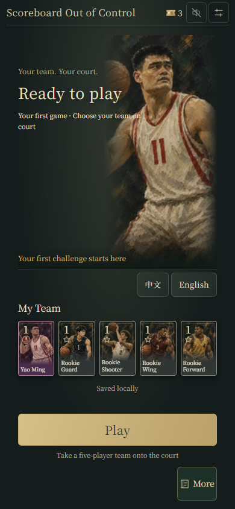
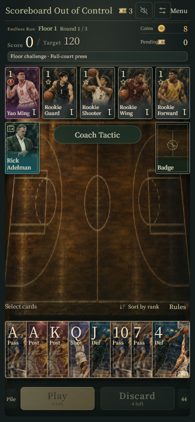
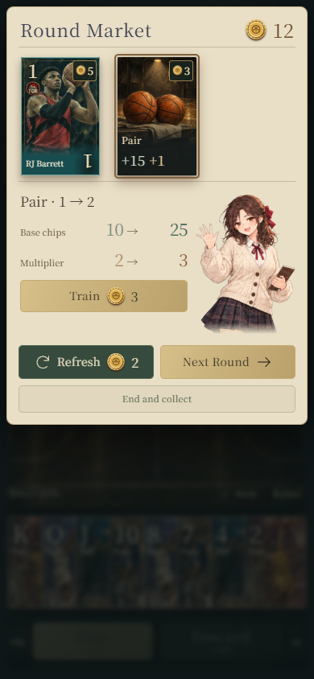
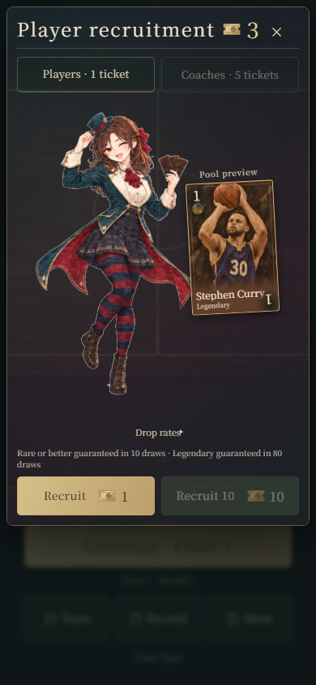
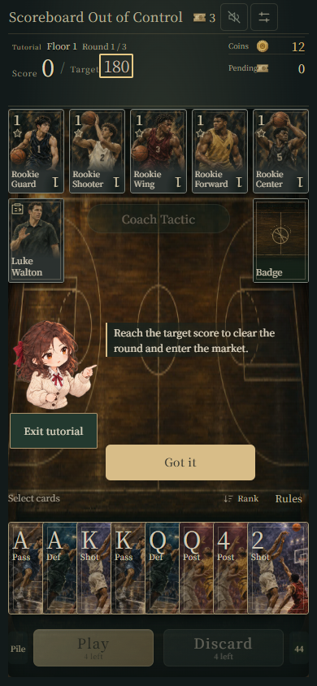

# Scoreboard Out of Control · Basketball Card Builder

[中文](README.md)

A basketball roster-building game built around poker hands. On every play, the player chooses how to use a limited number of plays and discards, combining hand types with player abilities to score and climb through an endless challenge.

This repository is a **portfolio**: it presents the game’s design, interfaces, and selected technical thinking, alongside a small standalone demonstration. It does not contain the complete game, its production code, or its full balancing data.

## Screenshots

These English-language screenshots show an in-development offline prototype, captured in an isolated browser with sample data. They are not screenshots from a physical phone or the published version. Select an image to view it at full size.

<table>
  <tr>
    <td width="50%"> Home</td>
    <td width="50%"> Match</td>
  </tr>
  <tr>
    <td> Market</td>
    <td> Recruitment</td>
  </tr>
  <tr>
    <td> Tutorial</td>
    <td></td>
  </tr>
</table>

## Game at a glance

- **Build a team:** Combine players, a coach, and a team badge; player abilities shape scoring decisions.
- **Play your hand:** Choose a poker hand while managing limited plays, discards, and round constraints.
- **Climb the floors:** Reach the target, then use the market to adjust the lineup and train hand types.
- **Explore combinations:** Recruitment and collection expand the roster, while market decisions change the current run.

## From idea to implementation

The project has evolved through gameplay design, balance adjustments, interface work, and practical feedback, using development tools and AI assistance to implement and validate iterations. Selected case studies:

- [Bringing basketball lineups into card decisions](docs/game-design.md#english)
- [Handling state and saving during frequent interactions](docs/state-and-feedback.md#english)
- [Improving a mobile interface through feedback](docs/design-iteration.md#english)

## Run the demonstration

[View the standalone hand demo](demo/index.html). Download the repository and open `demo/index.html` in a browser. The demo supports Chinese and English and needs no account or network connection.

The demo uses **independently written simplified rules and sample data** to explain the relationship between selecting cards, identifying a hand, and producing a score. It is not the complete game and does not represent its production balance or full scoring logic.

## About this repository

The documents, screenshots, and demonstration introduce the project. Full game assets, the complete player catalog, server code, save data, and production source are not included. Screenshots show the actual project; the demo is a separate illustrative example.
