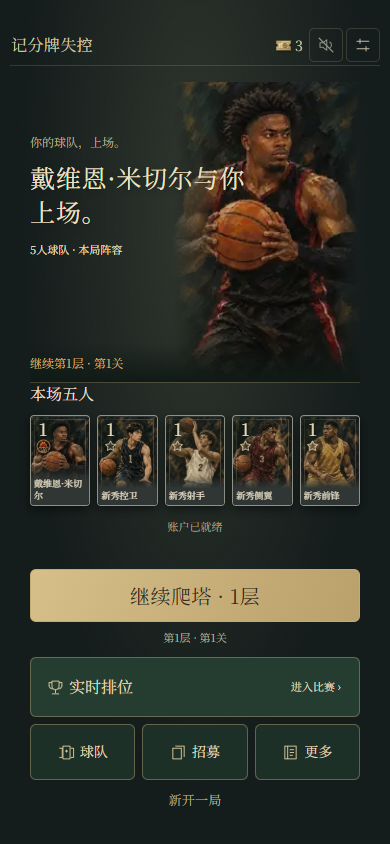
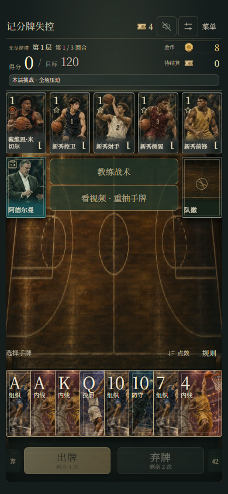
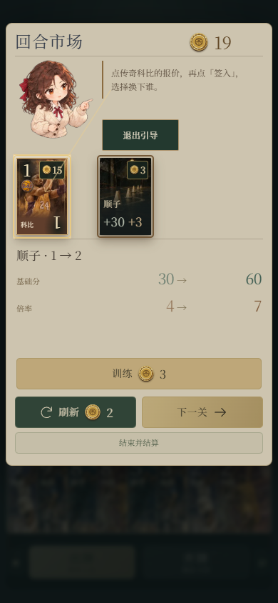
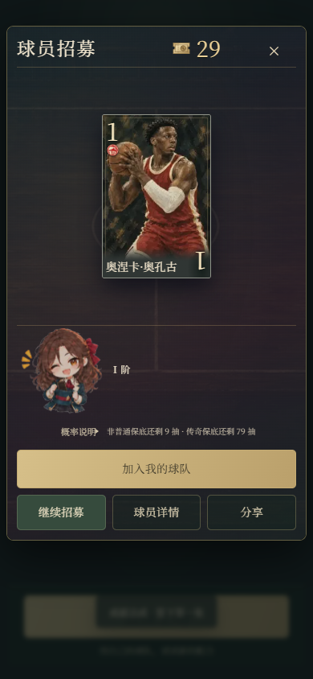

# 记分牌失控 · 篮球牌型构筑

[English](README.en.md)

一款把篮球阵容与扑克牌型结合的游戏。每一手，玩家要在有限的出牌与弃牌机会中组织手牌，让球员能力与牌型配合，积累分数，挑战更高的层数。

这个仓库是一份**作品集**：展示玩法设计、界面和部分技术思考，并提供独立的简化演示。它不包含完整游戏、正式数值体系或生产环境代码。

## 游戏画面

以下画面来自隔离浏览器中的不同开发版本，展示内容为测试示例，并非手机实机截图。点击图片可查看原图。

<table>
  <tr>
    <td width="50%"> 首页</td>
    <td width="50%"> 比赛</td>
  </tr>
  <tr>
    <td> 市场</td>
    <td> 球员招募</td>
  </tr>
</table>

更多画面：[新手引导](assets/screenshots/tutorial.png)

## 玩法概览

- **选择球队**：以球员、教练和队徽构建不同的组合，球员能力影响得分策略。
- **组织手牌**：从手牌中选择牌型，在出牌、弃牌和回合限制间做取舍。
- **逐层挑战**：达到本关目标后继续向上，途中利用市场调整阵容和训练牌型。
- **迭代成长**：招募与收藏让玩家逐渐探索不同球员；每局的市场选择也会改变当局阵容。

## 从设计到落地

项目围绕玩法构思、数值调整、界面设计与真实使用反馈持续迭代，并结合开发工具与 AI 协作实现和验证原型。这里选取几项思考：

- [把篮球阵容放进牌型决策](docs/game-design.md)
- [在频繁操作中处理状态与保存](docs/state-and-feedback.md)
- [从真实反馈出发改进移动界面](docs/design-iteration.md)

## 可运行示例

[查看独立牌型演示](demo/index.html)。将仓库下载到本地后，直接在浏览器中打开 `demo/index.html`；演示支持中文和英文，无需账号或网络。

演示使用**独立编写的简化规则与示例数据**，只用于解释“选择手牌 → 识别牌型 → 形成得分”的基本关系，不代表完整游戏的玩法、平衡或正式结算。

## 关于本仓库

仓库中的文档、截图和演示用于介绍本项目；完整游戏资源、球员数据、服务端、存档数据和生产代码没有包含在内。截图展示实际项目画面，演示则是与完整游戏分开的示例。
